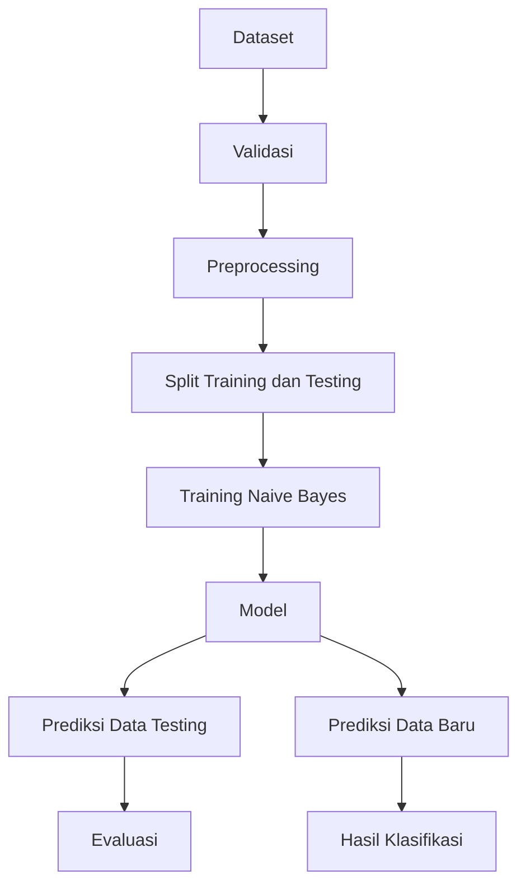

# High Level Design (HLD)

## 1. Arsitektur
Sistem menggunakan arsitektur web sederhana:

```text
Browser
   |
   v
Frontend
   |
   v
REST API / Backend
   |
   +---- Dataset Service
   +---- Preprocessing Service
   +---- Naive Bayes Service
   +---- Evaluation Service
   |
   v
Database
```

## 2. Komponen
### Frontend
Menampilkan dashboard, dataset, proses training, evaluasi, dan prediksi.

### Backend
Menangani autentikasi, dataset, proses klasifikasi, dan API.

### Naïve Bayes Service
Menghitung probabilitas kelas berdasarkan data training dan menghasilkan kelas prediksi.

### Database
Menyimpan pengguna, dataset, model, hasil evaluasi, dan prediksi.

## 3. Alur Klasifikasi


